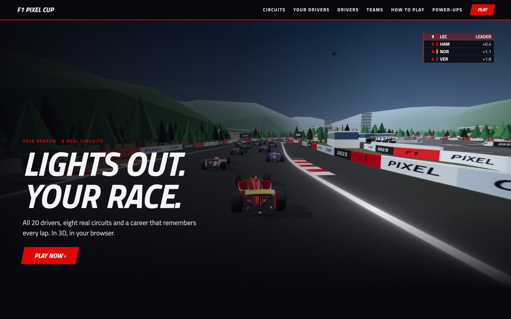
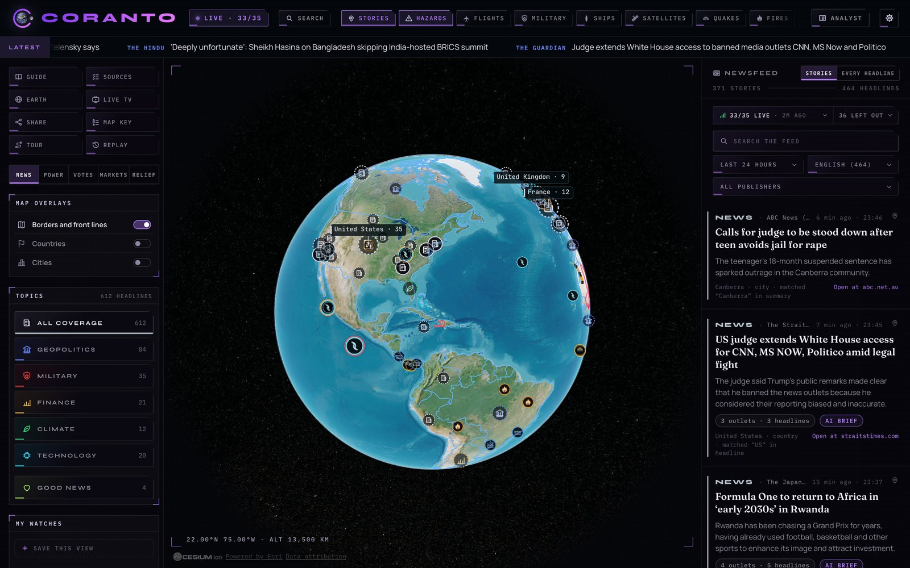

## Connor Evans

Design engineer in Chicago. I build interactive software for the web, mostly in React and Three.js, and increasingly with AI inside it.

Two principles run through the work. An interface should hold up down to the smallest detail, and software that acts on your behalf should show you exactly what it did and let you undo it.

At Flexport, alongside my sales role, I was chosen to lead workflow automation for the sales team. That work became Scout, an internal tool now used by Flexport sales teams in more than 30 countries. Before Flexport, I founded two small software companies while studying at UNC.

 

#### Selected work

<table>
<tr>
<td width="50%" valign="top">

<h4><a href="https://chicago-open-world.vercel.app">Chicago Open World</a></h4>
The whole city in 3D, built from City of Chicago and OpenStreetMap data. More than 100,000 buildings stand at their real heights, and their windows light up as the real sun sets.
 <a href="https://chicago-open-world.vercel.app">Live</a> · <a href="https://github.com/AllStreets/Chicago-Open-World">Source</a> · React, Three.js
</td>
<td width="50%" valign="top">

<h4><a href="https://f1-pixel-cup.vercel.app">F1 Pixel Cup</a></h4>
A racing game in the browser with the 2025 grid on eight circuits traced from their real layouts. Rain, night races, and power-ups that recast Mario Kart items as F1 rules.
 <a href="https://f1-pixel-cup.vercel.app">Live</a> · <a href="https://github.com/AllStreets/F1PixelCup">Source</a> · Three.js, Canvas · Unofficial fan project
</td>
</tr>
<tr>
<td width="50%" valign="top">

<h4><a href="https://coranto-production.up.railway.app">CORANTO</a></h4>
Real news on a live 3D globe. Every headline carries its publisher, link, time and place, stories are grouped across outlets, and when a source is down the page says so. An analyst board turns pinned stories into briefs, and anything a model wrote is labeled as such.
 <a href="https://coranto-production.up.railway.app">Live</a> · <a href="https://github.com/AllStreets/coranto">Source</a> · JavaScript, CesiumJS, Node, Supabase
</td>
<td width="50%" valign="top">

<h4><a href="https://crucible-weld.vercel.app">Crucible</a></h4>
Open-source AI agents, cloned at pinned commits and run against one another on a shared machine, with the results published as a readable record. Every number on the page is a count of rows you can open.
 <a href="https://crucible-weld.vercel.app">Live</a> · Next.js, Python
</td>
</tr>
</table>

#### Also built

- **[CHI ATLAS](https://chi-nine-zeta.vercel.app)**: a mission-control room for one city, with live CTA trains, scores and lake conditions on a 3D map of Chicago. [Source](https://github.com/AllStreets/chi)
- **[GAM3](https://hyperion-flax.vercel.app)**: a browser game about running a private orbital agency, with real orbital mechanics over a live Earth. [Source](https://github.com/AllStreets/GAM3)
- **[ONEXUS Agents](https://onexus-agents.vercel.app)**: an evidence-graded catalog of open-source AI agents, ranked by published weights, with every claim labeled by how it was verified. [Source](https://github.com/AllStreets/ONEXUS-Agents)
- **[loom](https://github.com/AllStreets/loom)**: an offline computer that extends itself. Describe a capability in one sentence and a local model plans it, writes and tests the code, and asks permission before it runs.
- **[ember](https://github.com/AllStreets/ember)**: an offline console for when the grid goes down, with a local model, field guides and navigation, and no external requests.

#### Agent safety

Beneath the interfaces, much of my work concerns how AI agents earn permission to act, and how to stop one that should not. [ONEXUS](https://github.com/AllStreets/ONEXUS) is a local-first runtime that checks every tool call an agent makes against the manifest it declared and records each decision in an audit ledger. I [red-teamed it myself](https://github.com/AllStreets/ONEXUS/blob/main/docs/REDTEAM-AEGIS.md) and published what broke and how I fixed it. [SMADP](https://github.com/AllStreets/SMADP) analyzes agents that share a filesystem, clipboard and OAuth scopes, and grades each verdict by how it was verified.

 

connorevans29@gmail.com
